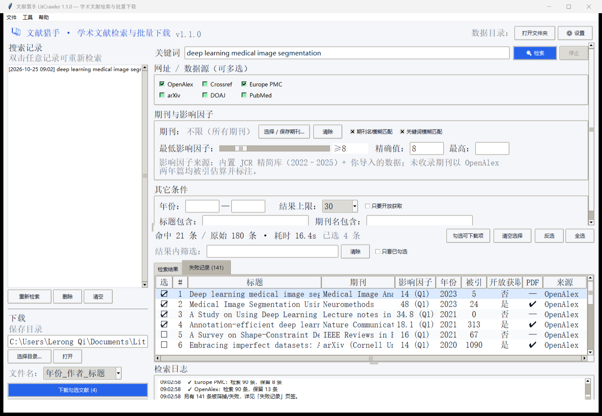
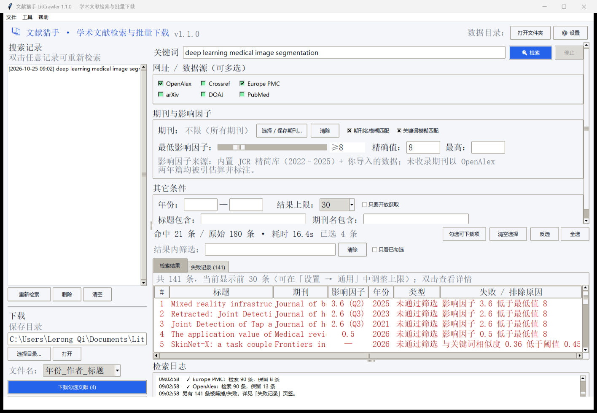

# LitCrawler · 文献猎手

[](LICENSE)
[](https://www.python.org)
[](#)

一个**独立运行**的学术文献检索与批量下载工具（Python + Tkinter，零第三方依赖、跨平台）。

输入关键词、网址（数据源）、期刊名称、最低影响因子 → 得到结果列表 → 打勾挑选 →
选择下载目录 → 批量下载 PDF。搜索记录自动保存，可双击一键复现。



> 截图：检索 “deep learning medical image segmentation”，勾选 4 篇，影响因子 ≥ 5。

---

## 直接下载（不会用 Python 也能装）

打开 **[Releases](../../releases/latest)** 页面，下载 `LitCrawler.exe`，双击即可运行：

* 单文件、免安装，约 15 MB，不需要 Python 环境；
* 支持 Windows 10 / 11（64 位）；
* 首次运行若出现 SmartScreen 提示，点「更多信息 → 仍要运行」即可
  （程序由 PyInstaller 打包且未做代码签名，属正常现象）；
* 想放到桌面：右键 `LitCrawler.exe` → 发送到 → 桌面快捷方式。

---

## 快速开始（源码运行）

### 方式一：双击启动（推荐）

```
双击  启动 LitCrawler.bat
```

### 方式二：命令行

```bat
python -m litcrawler                :: 打开图形界面
python -m litcrawler gui            :: 同上
python run_litcrawler.py            :: 同上
```

环境要求：**Windows / macOS / Linux + Python 3.9 及以上**（Windows 安装 Python 时勾选
`Add Python to PATH`，并确保安装了官方发行版自带的 Tkinter）。
程序运行**不需要 pip 安装任何第三方包**；只有导入/导出 Excel（.xlsx）才需要 `openpyxl`。

### 方式三：自己打包成单文件 EXE

```bat
双击  打包 EXE.bat
:: 或手动：
python -m pip install pyinstaller
python -m PyInstaller packaging\LitCrawler.spec --noconfirm
:: 产物：dist\LitCrawler.exe  （约 15 MB，双击即用）
```

打包后 `启动 LitCrawler.bat` 会自动优先运行 exe。

---

## 功能对照

| 你的需求 | 实现方式 |
| --- | --- |
| 输入关键词，**支持模糊搜索** | 数据源原生相关度检索 + 本地 `difflib` 相似度重排；拼写错误（`neural netwrok`）、词序不同、只输入部分关键词都能命中，可在界面关闭“关键词模糊匹配”切换严格模式 |
| 输入**网址名称（1 个或多个，支持保存）** | 内置 6 个数据源可多选：OpenAlex、Crossref、Europe PMC、arXiv、DOAJ、PubMed；另有「设置 → 自定义站点」，用「地址模板 + 正则」接入任意可抓取的期刊网站，配置自动保存 |
| 输入**期刊名称（一个或多个）** | 「选择 / 保存期刊…」对话框支持多选、搜索、增删，清单持久保存；匹配支持中英文名、常见缩写（`J Am Chem Soc` ↔ 全称）、ISSN 精确匹配与模糊匹配 |
| 输入**最低影响因子数值** | 滑块 + 精确输入框，可同时设上限；**结果严格按区间过滤**（无 IF 数据的记录在有下限/上限时会被排除）。内置 JCR 精简库（2022–2025，8.8 万条，含分区/学科），可导入自有 JCR/LetPub 数据，未收录期刊用 OpenAlex 两年篇均被引估算并标注 |
| **显示搜索记录** | 左侧「搜索记录」列表，含时间、关键词、期刊、IF 条件与结果数；双击即可还原全部条件并重新检索 |
| 返回所有查到的文献 | 多源并发检索 → DOI/标题双重去重 → 期刊信息补全 → 过滤排序，表格展示标题/期刊/影响因子/年份/被引/OA/PDF/来源；表头上方可按标题/期刊/作者/DOI/来源二次筛选，或勾选「只看已勾选」 |
| **★ 条件收窄时秒出结果** | 新的检索范围若是上一次的子集（提高最低 IF、缩小年份、减少数据源/期刊），直接在上一轮结果里本地筛选，**不再联网**，通常 0.1–0.3 秒完成；放宽条件才重新检索 |
| **★ 失败记录（红色）** | 「失败记录」页签用红色列出：被条件筛掉的文献（写明"影响因子 3.6 低于最低值 8"等原因）与下载失败的文献；双击看详情；显示条数可在「设置 → 通用」调整 |
| **★ 可拖动的日志栏** | 结果区与日志区之间的分隔线可上下拖动，想看日志就往上拉 |
| **由用户打勾选取下载哪些** | 结果表第一列即勾选框（绿色方块 + 对勾），支持全选、反选、清空、「只勾选可下载项」，可拖动多选后按空格批量切换 |
| **选择下载的文件目录** | 左侧「下载」区选择目录（弹窗选择或直接编辑），路径自动记住 |
| **之后下载** | 多线程并发下载 PDF，自动跳过已有文件，文件名可选 3 种格式，失败逐条给出原因并进红色失败页签 |



> 「失败记录」页签：红色的 141 条里，既有"影响因子 3.6 低于最低值 8"被筛掉的，也有下载失败的，都写明原因。

---

## 界面速览

```
┌──────────────────────────────────────────────────────────────────────────┐
│  📚 文献猎手 · 学术文献检索与批量下载          [打开文件夹] [⚙ 设置] │
├───────────────┬──────────────────────────────────────────────────────────┤
│ 搜索记录      │ 关键词 [ deep learning medical imaging ] [🔍 检索] [停止] │
│ ▸ [10:22] …   │ ┌ 网址 / 数据源（可多选）────────────────────────────┐   │
│ ▸ [10:05] …   │ │ ☑OpenAlex ☑Crossref ☑Europe PMC ☐arXiv ☐DOAJ ☐PubMed│  │
│ [重新检索][删]│ └────────────────────────────────────────────────────┘   │
│               │ ┌ 期刊与影响因子 ───────────────────────────────────┐   │
│ ── 下载 ──    │ │ 期刊：IEEE TMI、Nature…  [选择/保存期刊…]          │   │
│ 保存目录 […]  │ │ 最低影响因子：━━━━●━━━  ≥5   最高：__              │   │
│ [选择目录…]   │ └────────────────────────────────────────────────────┘   │
│ [下载勾选(3)] │ ┌ 其它条件：年份 2018—2025  结果上限 50  ☐只要开放获取┐  │
│ [导出链接]    │ └────────────────────────────────────────────────────┘   │
│               ├──────────────────────────────────────────────────────────┤
│               │ 命中 24 条 / 原始 132 条 · 耗时 6.3s      已选 3 条     │
│               │  选 # 标题        期刊      IF   年份 被引 OA PDF 来源  │
│               │  ☑ 1 Deep learning… IEEE TMI 12.4 2023  89  是  ✔ OpenAlex│
│               │  ☐ 2 A survey of…  Nature   48   2021 210  是  ✔ OpenAlex│
│               │ ── 检索日志 ─────────────────────────────────────────────│
│               │ 10:22:03 ✓ OpenAlex 返回 36 条（1.5s）                   │
└───────────────┴──────────────────────────────────────────────────────────┘
```

---

## 数据源

| 名称 | 覆盖范围 | 免费 PDF | 说明 |
| --- | --- | --- | --- |
| **OpenAlex** | 2.5 亿+ 全学科 | 有（OA 直链） | 默认首选，含摘要、期刊名与 ISSN |
| **Crossref** | 1.5 亿+ DOI | 少量 | 元数据最权威，出版商链接 |
| **Europe PMC** | 生命科学/医学 | 有（OA 全文） | 开放获取论文可直接下载 PDF |
| **arXiv** | 数理/计算机/物理 | 全部 | 预印本，直接 PDF |
| **DOAJ** | 开放获取期刊 | 全部 | 全部免费全文 |
| **PubMed** | 生物医学 | PMC 部分 | NCBI E-utilities，无需 Key |
| 自定义站点 | 任意可抓取页面 | 视站点 | 「设置 → 自定义站点」配置 |

> 检索全部走公开 API，**不绕过付费墙**。订阅文献会给出链接但无法直接下载，程序会明确提示原因。

---

## 影响因子数据

* **内置库**：`litcrawler/resources/impact_factor_jcr.tsv.gz`，8.8 万条记录，覆盖 2022–2025 年
  JCR 影响因子、分区（Q1–Q4）、学科与收录库，离线可用。
  整理自 MIT 许可的公开数据集 [lcpmgh/Journal](https://github.com/lcpmgh/Journal)（数据源自公开 JCR 资料）。
* **导入自有数据**：菜单「工具 → 导入影响因子数据」，支持 CSV / TSV / JSON / XLSX。
  程序会自动识别列名，以下写法都能认：
  `JIF`、`IF`、`Impact Factor`、`影响因子`、`2024 JIF`、
  `Journal`、`期刊名称`、`ISSN`、`eISSN`、`JCR 分区`、`学科` 等。
  导入的数据会**覆盖**内置库中同刊同名记录，并保存到数据目录。
* **完整数据集**：菜单「工具 → 下载完整 JCR 数据集（约 40MB）」可拉取 2019–2025 全量数据。
* **兜底估算**：库里没有的期刊，用 OpenAlex 的 *2 年平均篇均被引* 估算，结果中以
  “（估算）”标注来源，不会与 JCR 数值混淆。

> 影响因子仅作检索筛选参考。正式科研评价请以 JCR 官方数据为准。

---

## 命令行模式

```bat
:: 检索
python -m litcrawler search "deep learning medical imaging" --min-if 5 -n 20

:: 指定数据源与期刊
python -m litcrawler search "graph neural network" -s "OpenAlex,Europe PMC" -j "Nature,Machine Learning" -n 30

:: 检索并直接下载开放获取 PDF
python -m litcrawler download "drug discovery" --min-if 4 -n 10 -o D:\papers --workers 4

:: 结果存成表格
python -m litcrawler search "crispr" -n 50 --save-csv D:\results.xlsx

:: 影响因子库
python -m litcrawler if-status --check Nature Lancet "IEEE TMI"
python -m litcrawler if-import "D:\jcr2024.csv"

:: 数据源连通性自检
python -m litcrawler probe
```

---

## 目录结构

```
lit-crawler/
├── 启动 LitCrawler.bat         # 双击启动图形界面
├── 命令行检索.bat              # 双击做一次命令行检索
├── 打包 EXE.bat                # 一键打包成单文件 exe
├── run_litcrawler.py           # 统一入口（GUI / CLI / 打包）
├── pyproject.toml
├── packaging/LitCrawler.spec   # PyInstaller 单文件打包
├── litcrawler/
│   ├── cli.py  __main__.py
│   ├── core/
│   │   ├── config.py           # 设置、搜索记录、期刊清单、自定义站点
│   │   ├── fuzzy.py            # 关键词/期刊模糊匹配（缩写、词形、拼写容错）
│   │   ├── http.py             # 标准库 HTTP 客户端（重试、UA、编码兜底）
│   │   ├── impactfactor.py     # 影响因子库（内置 + 导入 + 下载 + 模糊查找）
│   │   ├── models.py           # Paper / SearchResult 数据模型
│   │   ├── search.py           # 多源并发检索、去重、补全、过滤、排序
│   │   └── downloader.py       # 并发 PDF 下载、文件名净化、断点跳过
│   ├── sources/                # 数据源适配器（OpenAlex/Crossref/Europe PMC/arXiv/DOAJ/PubMed + 自定义）
│   ├── gui/                    # Tkinter 界面（app.py / dialogs.py / widgets.py）
│   └── resources/              # 内置影响因子库
├── tests/
│   ├── smoke_test.py           # 离线单测（不联网）
│   ├── test_new_features.py    # 影响因子过滤 / 失败原因 / 本地快速筛选
│   ├── e2e_online.py           # 联机端到端：检索 → 下载 → 校验
│   ├── gui_live_test.py        # 界面实机测试（真检索 + 真下载）
│   └── gui_v11_test.py         # v1.1 新功能实机测试
└── tools/build_if_bundle.py    # 把完整 JCR CSV 压缩成内置库
```

数据目录（设置、搜索记录、导入的影响因子）默认位于：

```
%APPDATA%\LitCrawler\
```

在程序目录放一个空的 `portable.txt` 即可切换为**便携模式**（数据存到程序目录下 `data\`）。

---

## 界面说明：两个容易疑惑的地方

**右上角「数据目录」旁边的「打开文件夹」是做什么的？**
它只是用资源管理器打开程序存放自己数据的位置（默认 `%APPDATA%\LitCrawler`），不涉及任何联网操作。
里面有：`settings.json`（你的设置）、`history.json`（搜索记录）、`journals.json`（常用期刊）、
`impact_factor\`（你导入的影响因子表）、`logs\`（运行日志）。
备份或换电脑时，把整个文件夹复制走即可连同设置和搜索记录一起迁移；也可以手动删除它来"重置"程序。

**「设置 → 通用」里的「联系邮箱」有什么用？**
OpenAlex、Crossref 这类学术 API 要求自动化程序在请求里带上联系方式。填上邮箱后，请求会附带
`mailto` 参数，你会进入它们的「礼貌池 (polite pool)」：**响应更快、更不容易被限流**，
对方在发现异常流量时也能联系你而不是直接封禁。留空也能用，只是速度可能慢一些。
它只会出现在发给这些 API 的请求参数里，不会上传到别处，也不会公开展示；随便填一个常用邮箱即可。

---

## 常见问题

**结果太少？**
降低最低影响因子、清空期刊限制、提高结果上限、多勾几个数据源。

**为什么把影响因子调高后结果变少了，却几乎立刻出来？**
因为条件收窄属于「子集」，程序会直接在上一次结果里筛选，不会再联网。只有放宽条件才会重新检索。

**期刊显示“—”没有影响因子？**
该刊未被 JCR 收录（如新刊、会议、预印本），或需要导入你自己的影响因子数据。
注意：设置了最低影响因子后，没有 IF 数据的记录也会被排除——原因会写在「失败记录」页签里。

**下载失败 / 提示“非 PDF”？**
多数订阅文献没有合法免费全文；有直链的 OA 文献才能下载。失败原因会逐条列出，
并进入红色的「失败记录」页签，可复制 DOI/链接后通过机构权限获取。

**会不会被网站封？**
程序自带请求间隔控制（arXiv 3 秒、Crossref/Europe PMC 0.3 秒左右），
并在「设置」里可填联系邮箱加入 OpenAlex/Crossref 的礼貌池。请勿把并发调到过高。

**自定义站点抓不到内容？**
仅支持服务端渲染的 HTML；知网、万方等依赖 JavaScript 渲染或需要登录的站点无法直接抓取，
请使用内置的开放数据源。

---

## 许可与致谢

* 本程序代码：MIT。
* 内置影响因子数据：整理自 [lcpmgh/Journal](https://github.com/lcpmgh/Journal)（MIT），
  原始指标版权归 Clarivate JCR 所有，仅供个人检索参考，请勿用于商业用途。
* 文献元数据来自 OpenAlex、Crossref、Europe PMC、arXiv、DOAJ、PubMed 的公开 API，
  使用时请遵守各自的使用条款。
